# Montra

Спокойный учёт личных денег для macOS: счета в разных валютах, расходы и доходы,
категории с обязательностью и финансовый месяц **от зарплаты до зарплаты**.

Сделан на SwiftUI и SwiftData, без сторонних зависимостей. Визуальный язык — в духе
[Purge](https://github.com/jithin-sabu/purge-app): типографика Onest, числа SF Rounded,
тёплый графит, приподнятые карточки.

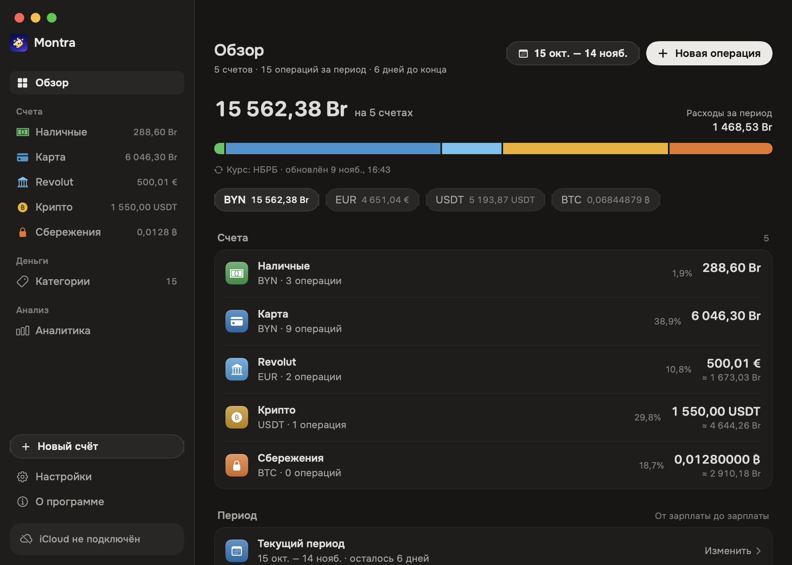

| Операции | Настройки |
|---|---|
| 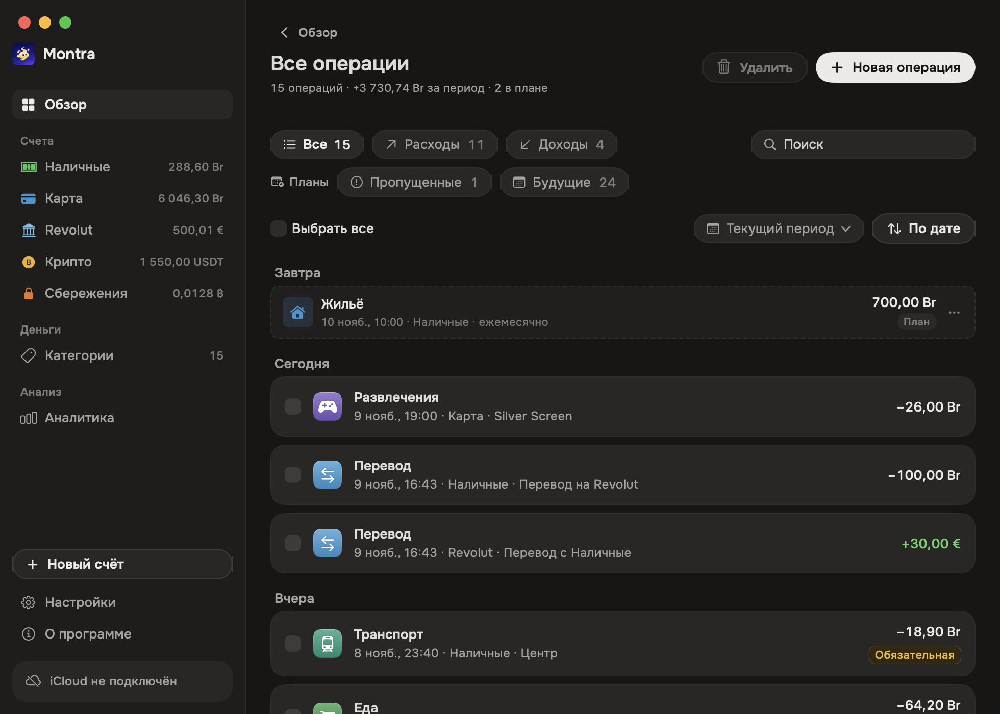 | 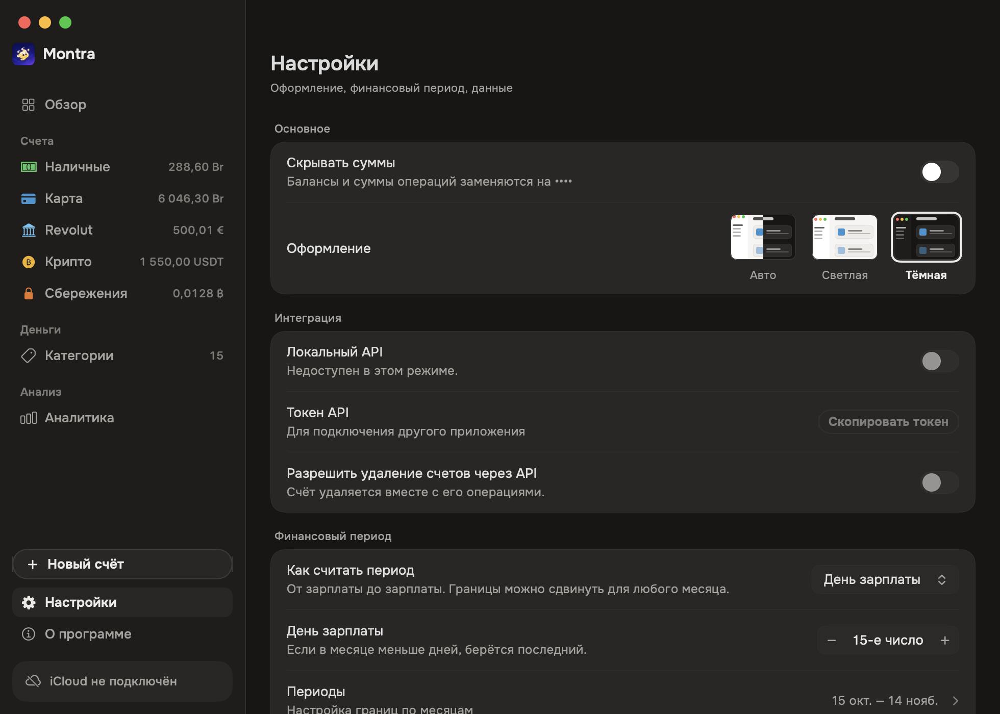 |

| Поиск | Ничего не найдено |
|---|---|
| 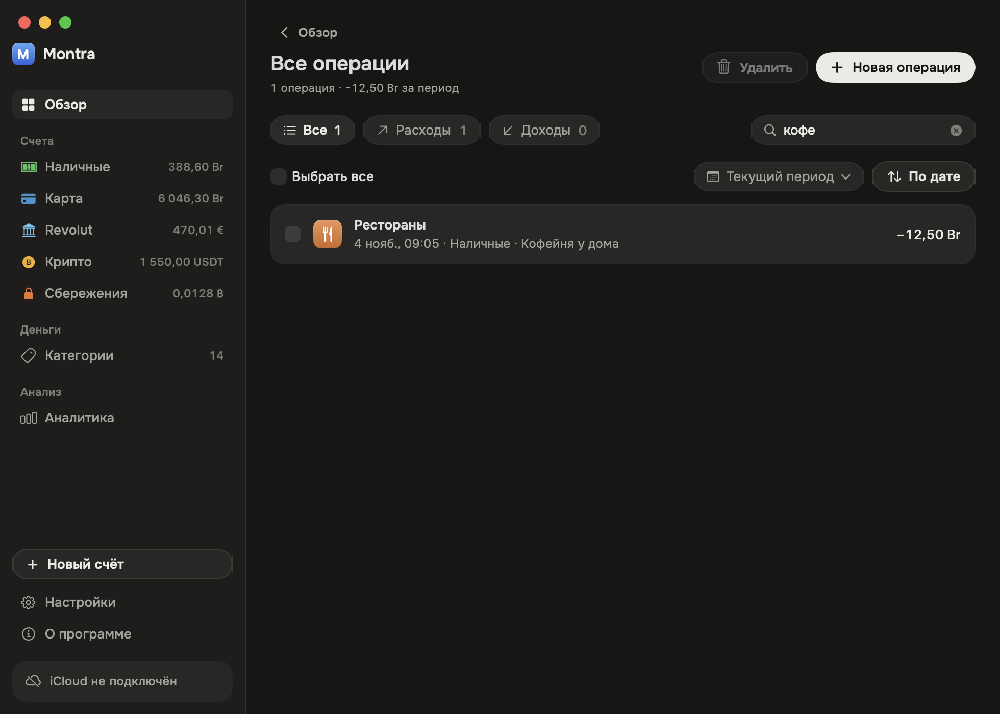 | 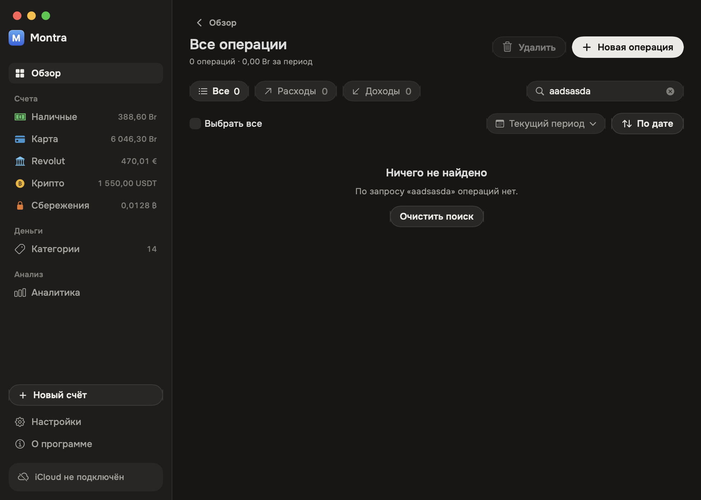 |

| Перевод | Детали перевода |
|---|---|
| 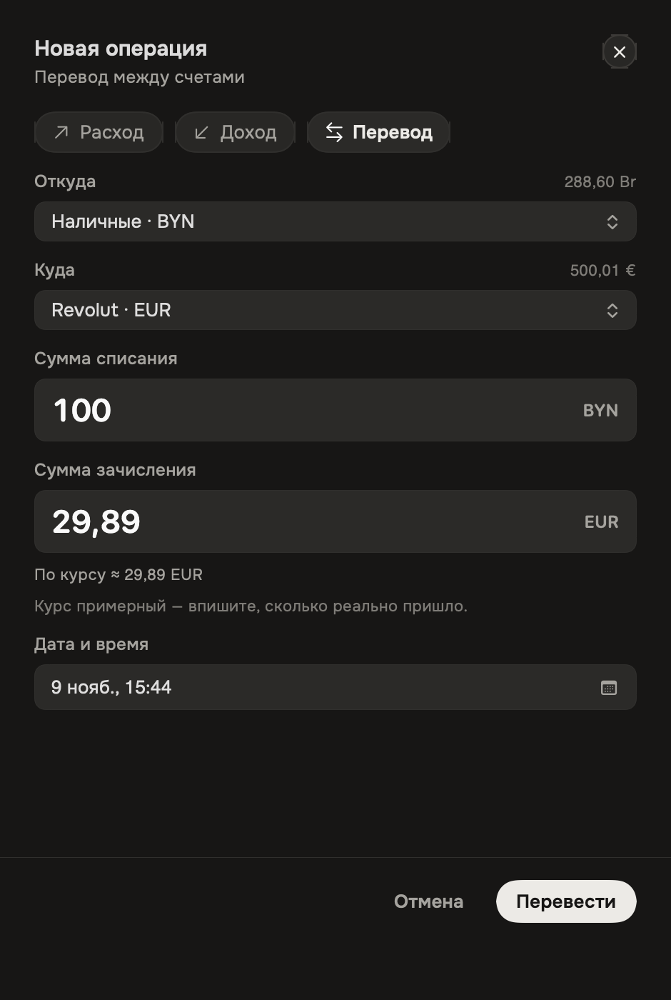 | 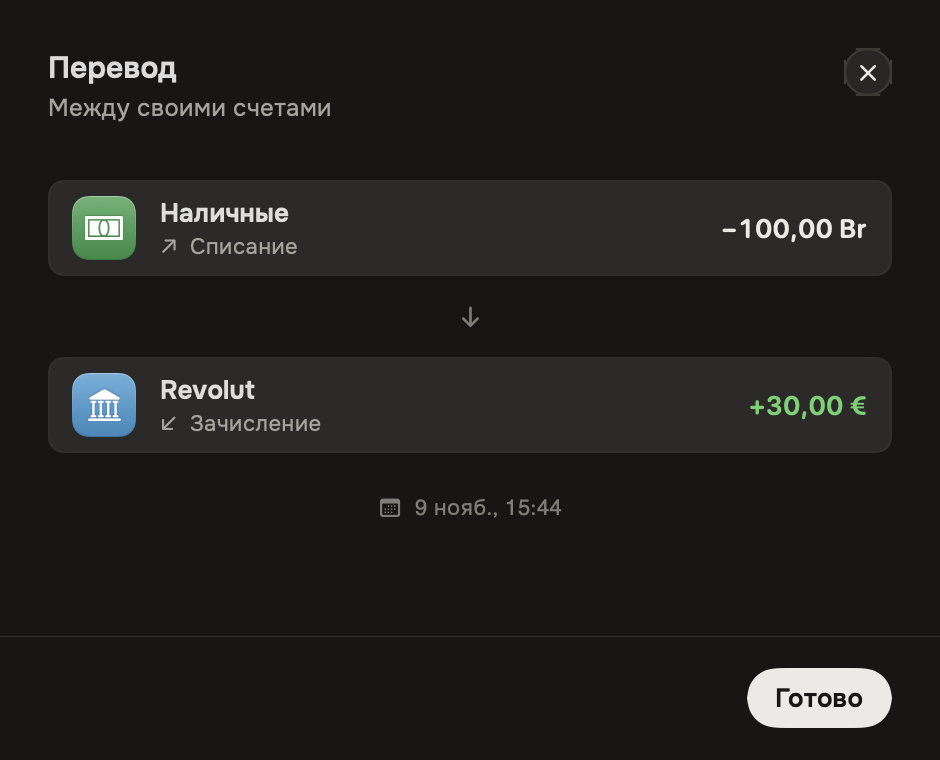 |

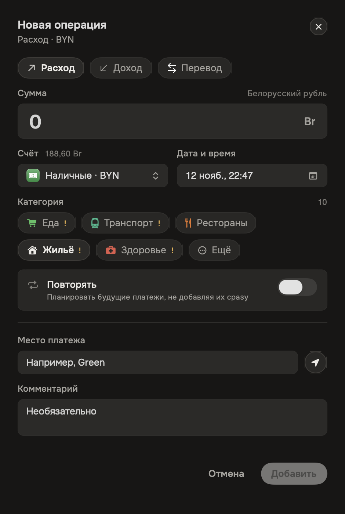

| Категории | Выбор категории |
|---|---|
| 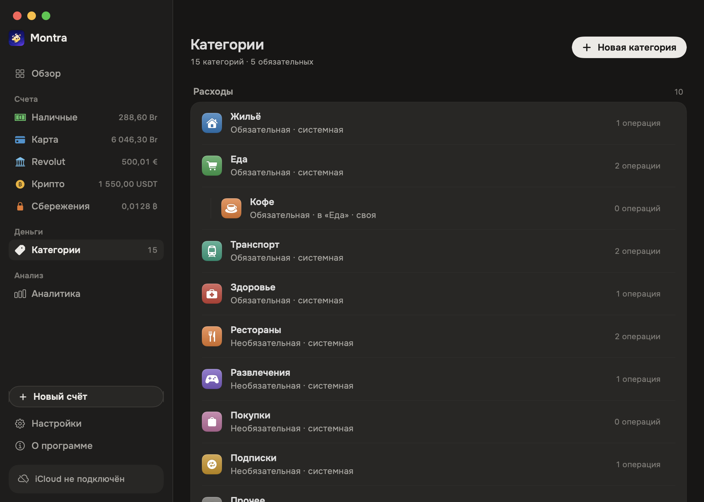 | 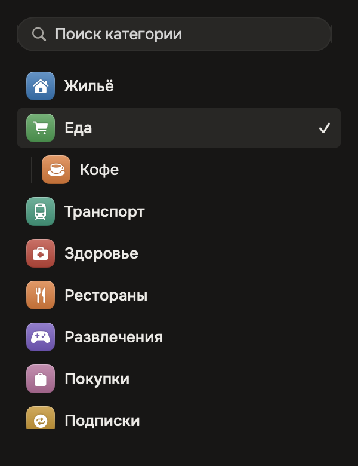 |

## Знакомство

| Приветствие | Первый счёт |
|---|---|
| 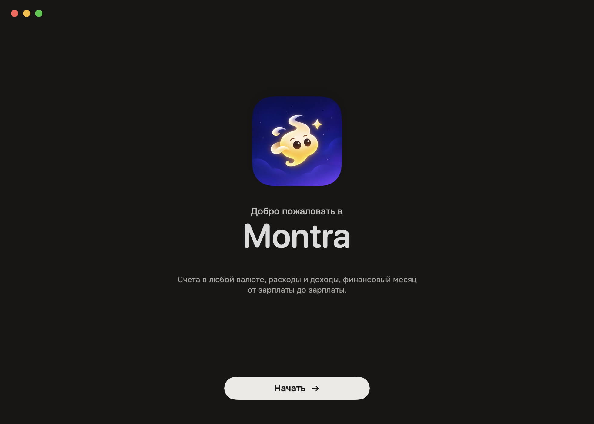 | 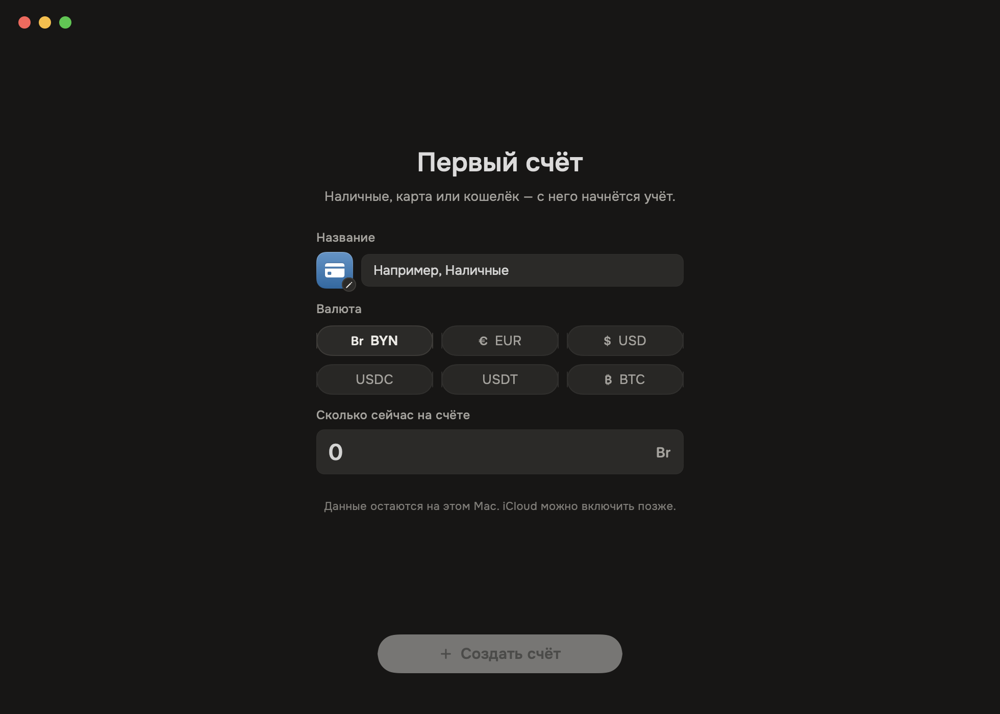 |

| Первый расход | Готово |
|---|---|
| 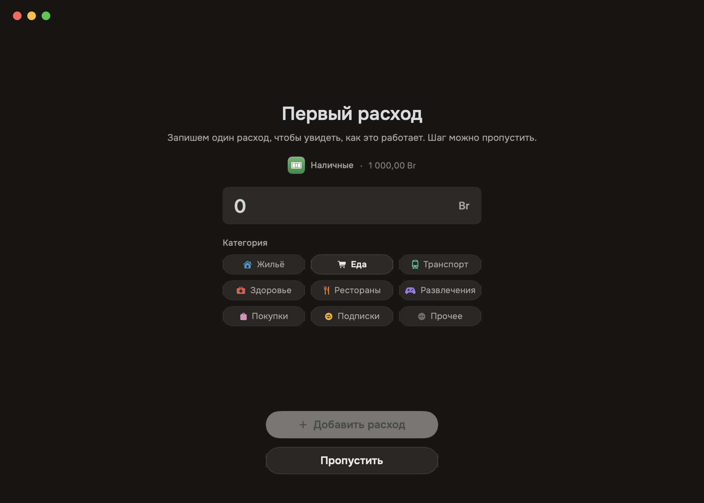 | 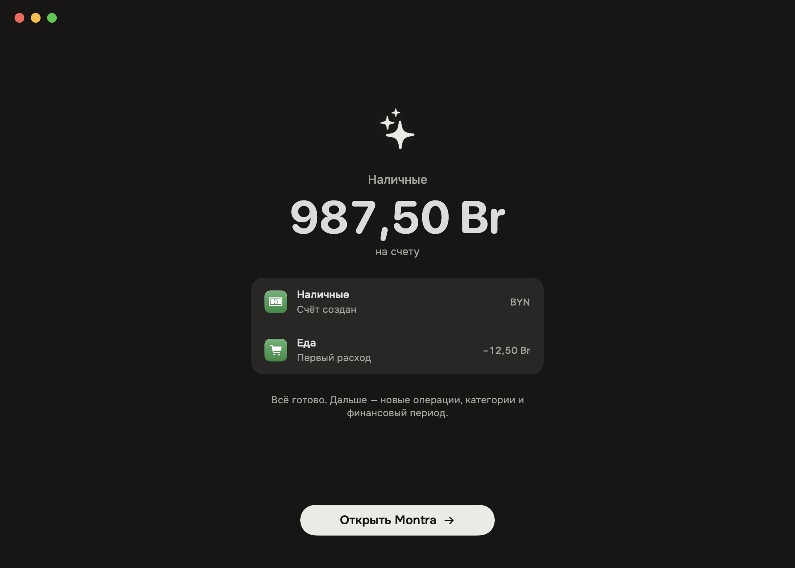 |

На шаге «Первый счёт» выбор валюты расположен под полем суммы.
Поток открывается на чистом хранилище. Попробовать его, не трогая данные:
`open -n -a Montra.app --args -preview-onboarding`.

> Полный инвентарь фич с ID, сценариями, проверками и edge cases для тестов —
> [Docs/Feature-Inventory.md](Docs/Feature-Inventory.md).

## Что умеет

- **Знакомство** — на первом запуске: приветствие, один настоящий счёт, выбор стартовых
  категорий (пропуск оставляет «Прочее»), первый расход (можно пропустить), финал и
  перелёт счёта в сайдбар; при Reduce Motion — спокойное растворение. Если закрыть
  приложение, не дойдя до финала, знакомство откроется снова при следующем запуске —
  созданный счёт при этом остаётся и используется дальше, заново его создавать не нужно.
- **Счета** — наличные, карта, банк, крипто. Иконка или emoji, цвет, одна из семи валют,
  начальная сумма. В форме сначала название, сумма и валюта, а внешний вид —
  иконка/emoji и цвет — последним блоком. Полный список значков открывается через
  «…», значок выбирается нажатием на плитку. Баланс считается по операциям. Счёт можно отметить
  **накопительным** — он уходит в группу «Накопления» в сайдбаре, но снимать и
  пополнять его можно как обычно. Любой счёт можно **скрыть из обзора**: он
  перестаёт попадать в итог, полосу и список счетов, но остаётся в сайдбаре,
  на своей странице и в аналитике; под списком появляется тихая строка
  «Скрыто из обзора».
- **Операции** — расход и доход. Валюта подтягивается из счёта, дата по умолчанию
  «сейчас» (можно выбрать другую), место текстом или из геолокации, комментарий.
  Редактирование, удаление с подтверждением списка и экраном успеха, мультивыбор. Отдельной вкладки нет: полный список
  открывается из обзора по «Все операции» (⌘2) как подстраница.
- **Переводы между счетами** — третья вкладка «Перевод» в «Новой операции»: тот же
  выбор счёта, что и у расхода/дохода; сумма списания и зачисления с кодом валюты;
  при разных валютах сумма зачисления подставляется по курсу, но её можно вписать
  руками — в историю попадёт фактическая. Две связанные операции, не искажающие
  расходы/доходы периода.
- **Повторяющиеся платежи** — в форме операции можно включить «Повторять»:
  день/неделя/месяц/год, дни недели и дата «повторять до». Планы показываются в списке
  (карточки как у операций, с бейджем «План») и не меняют баланс. Наступивший или пропущенный платёж можно
  **связать с уже внесённым фактом** или **сохранить как факт**, а также удалить только
  этот платёж или всю серию. В «Все операции» и на странице счёта есть фильтры
  **«Пропущенные»** и **«Будущие»** (до двух лет или до конца серии).
- **Удаление всех данных** сразу перезапускает знакомство на реальном хранилище;
  созданный счёт сохраняется, после знакомства открывается «Обзор». Незавершённое
  знакомство возвращается при следующем запуске, пока его не пройти; уже созданный
  счёт переиспользуется. Знакомство из
  «О программе» — предпросмотр без изменения данных (после него тоже «Обзор»).
- **Списки по дням** — операции сгруппированы секциями «Сегодня», «Вчера», «Завтра»
  и датами вроде «7 октября»; заголовки дней липкие при скролле.
- **Поиск по операциям** — капсула в стиле референса: ищет по категории, счёту, месту,
  комментарию, сумме и дате, с пересчётом счётчиков и суммы в хедере; пустое состояние
  с «Очистить поиск». ⌘F — фокус в поиск, Escape — очистить.
- **Категории** — 14 стартовых, обязательные и необязательные, свои с иконкой и цветом;
  подкатегории одного уровня (родитель выбирается при создании, обязательность
  наследуется). В операции — пять самых частых категорий и «Ещё» с поиском по всей
  иерархии. При удалении категории операции переходят в «Прочее», подкатегории
  становятся обычными.
- **Финансовый период** — день зарплаты или фиксированная длина; каждый месяц можно
  сдвинуть, соседние границы подтягиваются, история остаётся непрерывной.
- **Настройки** — тема (авто / светлая / тёмная), скрытие сумм, основная валюта,
  экспорт CSV, удаление всех данных.
- **Резервная копия** — один файл `*.montra` со счетами, операциями, категориями,
  плановыми платежами, периодами и настройками. Сохраняется из настроек, оттуда же загружается:
  Montra проверяет версию, контрольную сумму и все связи, показывает содержимое и только
  потом заменяет данные. Перед восстановлением можно сохранить текущее состояние.
  Формат и правила — [Docs/Backup.md](Docs/Backup.md).
- **О программе** — иллюстрация Montra, версия, общая сумма по счетам, «Что умеет Montra»
  и кнопка «Пройти знакомство заново» (онбординг с начала на временных данных).
- **Обзор** — деньги со всех видимых счетов в одной цифре по курсам, полоса
  распределения, обязательные расходы и свободный остаток периода, последние операции.
  Скрытые счета не участвуют в сумме и полосе, а строка «Скрыто из обзора» под
  списком ведёт к ним.
- **Курсы** — НБРБ для USD/EUR и открытый фид для крипты; кеш на 6 часов, ручное
  обновление, честная пометка источника. Наведение на счёт показывает его сумму и
  эквивалент в валюте отображения.
- **Счета в сайдбаре** — все счета под «Обзором» с балансами, один клик до страницы счёта.
  Накопительные счета собраны отдельной группой «Накопления». В заголовке каждой группы —
  круглый «+»: у «Счетов» он создаёт обычный счёт, у «Накоплений» — сразу с включённым
  накопительным. У группы со счетами «+» появляется при наведении на заголовок (с подсказкой
  «Новый счёт» / «Новый накопительный счёт»), у пустой группы виден сразу, чтобы было с чего
  начать. На странице счёта — тот же выбор операций, «Выбрать все» и удаление с
  подтверждением и экраном успеха, а рядом с «Все/Расходы/Доходы» — фильтры
  **«Пропущенные»** и **«Будущие»** для планов этого счёта.
- **Живые списки** — добавленная операция выезжает в список с короткой подсветкой, а суммы
  и счётчики перекатываются цифрами, как в референсе.
- **Задел под iCloud** — CloudKit-совместимые модели, репозитории, `SyncService` и
  инструкция. Синхронизация пока выключена.

## Резервная копия

| Настройки → Резервная копия | Восстановление |
|---|---|
| 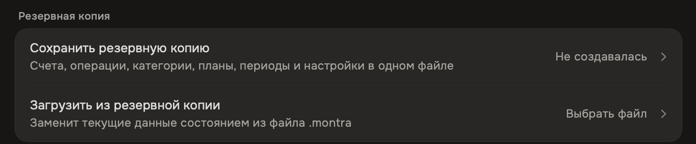 | 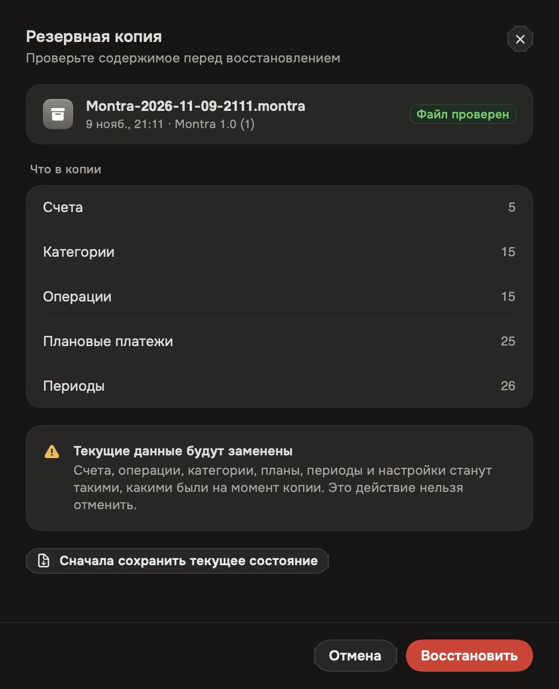 |

Файл `Montra-2026-11-09-2057.montra` — это JSON в собственной обёртке: счета, операции
с обеими частями переводов, категории с подкатегориями, плановые платежи, периоды,
настройки, курсы на день копии и переключатели локального API. Суммы лежат строками,
поэтому `0,0128 BTC` возвращается ровно тем же. Перед заменой данных Montra проверяет
версию формата, SHA-256 содержимого и все ссылки между записями; повреждённый файл
ничего не стирает. Токен локального API в копию не входит — это секрет конкретного Mac.

Формат, поля и правила совместимости — [Docs/Backup.md](Docs/Backup.md).

## Сборка и запуск
```bash
xcodebuild -project Montra.xcodeproj -scheme Montra -configuration Debug build
open ~/Library/Developer/Xcode/DerivedData/Montra-*/Build/Products/Debug/Montra.app
```

Или откройте `Montra.xcodeproj` в Xcode и нажмите ⌘R. Требуется macOS 15+ и Xcode 16+
(проект собран на Xcode 27).

## Язык приложения

Montra поддерживает английский и русский. Язык берётся из macOS. Чтобы выбрать язык
только для Montra, добавьте приложение в **Системные настройки → Основные →
Язык и регион → Приложения**, выберите язык и откройте Montra заново.

Переводы хранятся в каталогах Xcode в `Montra/Resources`: интерфейс в
`Localizable.xcstrings`, фразы Spotlight в `AppShortcuts.xcstrings` и системные
разрешения в `InfoPlist.xcstrings`.

## Горячие клавиши

| Клавиши | Действие |
|---|---|
| ⌘N | новая операция |
| ⇧⌘N | новый счёт |
| ⌘1…⌘4 | Обзор, Операции, Категории, Аналитика |
| ⌘, | Настройки |

Курсы обновляются автоматически; в настройках есть группа «Курсы валют» с источником,
таблицей и кнопкой обновления.

На MacBook с Touch Bar в активном окне Montra есть «Обзор», «Аналитика», кнопка
«+» и полоса всех счетов — обычных и накопительных. Полоса занимает свободное место
и прокручивается, так что счета видны при любом их числе; открытый счёт в ней
подсвечен, а «+» открывает новую операцию сразу по нему. Пока открыт лист или идёт
знакомство, панель не показывается.

## Spotlight

На macOS 26+ после начальной настройки Montra нажмите ⌘Пробел, затем ⌘3 и найдите действие:
«Добавить расход», «Добавить доход», «Перевести между счетами», «Создать счёт»,
«Создать категорию», «Создать подкатегорию», «Баланс счёта» или «Все счета».
Заполните поля в Spotlight и нажмите Enter. Для перевода между разными валютами укажите
обе суммы. Действие «Все счета» показывает остатки и общий итог в выбранной валюте.

## Разработка

```bash
# Арифметика периодов, балансов, знаков и категорий
.../Montra.app/Contents/MacOS/Montra -selftest

# Рендер всех экранов в PNG (использует временную базу в памяти)
.../Montra.app/Contents/MacOS/Montra -snapshot /tmp/montra-snaps

# Пройти знакомство на временном хранилище, не трогая настоящие данные
open -n -a .../Montra.app --args -preview-onboarding

# Обновить иконку приложения из MontraArtwork.imageset
swift Scripts/make-icon.swift Montra/Resources/Assets.xcassets/AppIcon.appiconset
```

Полный список фич с ID, smoke-набором и сценариями для тестов —
[Docs/Feature-Inventory.md](Docs/Feature-Inventory.md).

### Новая фича

У каждой фичи обязательный цикл: код → бэкап → Local API/MCP → локализация →
тесты → DMG. Правило, ворота и команды — в
[Docs/Feature-Workflow.md](Docs/Feature-Workflow.md); skill для агента —
`.agents/skills/montra-feature-release/SKILL.md`.

```bash
# проверить, что фича синхронизирована с бэкапом, API, MCP и переводами
python3 Scripts/audit-feature-sync.py

# собрать Release, прогнать selftest и получить DMG для установки
Scripts/make-dmg.sh <tag> --open
```

### Структура

```
Montra/
  App/          точка входа, окно, роутинг, модель приложения
  Design/       токены, компоненты, формы, бренд
  Models/       Currency, Account, Category, Operation, Period
  Store/        настройки, периоды, финансовая математика, репозитории, сиды, CSV
  Backup/       формат .montra, сборка и восстановление копии, файловые панели
  Sync/         задел под CloudKit
  Features/     Sidebar, Overview, Operations, Accounts, Categories, Analytics,
                Settings, About
  Snapshot/     снапшот-рендер и self-test
  Resources/    Onest, ассеты
Docs/           iCloud-инструкция, формат резервной копии, шаблон entitlements, скриншоты
```

Данные — SwiftData; записи идут через репозитории, чтобы будущий движок синхронизации
подключался в одном месте. Подробности продукта и дизайна — в [MasterPrompt.md](MasterPrompt.md),
план работ — в [PLAN.md](PLAN.md).

## iCloud

Сейчас выключен. Как включить — [Docs/iCloud-Setup.md](Docs/iCloud-Setup.md).

## Лицензии

- Шрифт **Onest** — SIL Open Font License 1.1, см.
  `Montra/Resources/Fonts/Onest-OFL.txt`. Файл шрифта взят из проекта Purge, цифры в нём
  удалены; все числа в интерфейсе рисуются системным SF Rounded.
- Вдохновение интерфейсом — Purge (Jithin Sabu). Код Montra самостоятельный.
