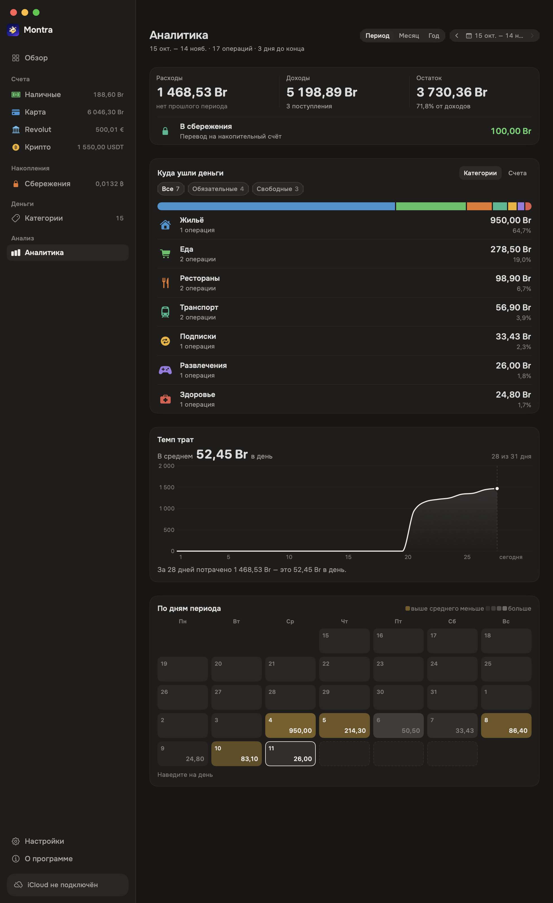
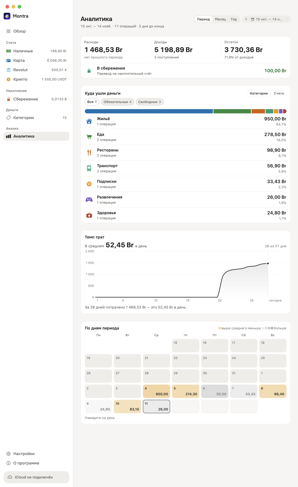

# Montra

Montra is a personal finance app for macOS. Track accounts in multiple currencies,
expenses and income, mandatory spending, and a financial month that runs **from
payday to payday**.

Built with SwiftUI and SwiftData without third-party dependencies. The interface
uses Onest typography, SF Rounded numerals, warm graphite tones, and raised cards.


| Transactions | Settings |
|---|---|
|  |  |

| Search | No results |
|---|---|
|  |  |

| Transfer | Transfer details |
|---|---|
|  |  |


| Categories | Category picker |
|---|---|
|  |  |

| Analytics | Analytics (light) |
|---|---|
|  |  |

## Onboarding

| Welcome | First account |
|---|---|
|  |  |

| First expense | Done |
|---|---|
|  |  |

Onboarding opens on a fresh store. To preview it with a temporary store, run
`open -n -a Montra.app --args -preview-onboarding`.

The [feature inventory](Docs/Feature-Inventory.md) lists feature IDs, scenarios,
checks, and edge cases.

## Features

- **Onboarding.** Create a real account, choose starter categories, and record
  your first expense. You can skip category selection and keep Other, or skip the
  first expense. On completion the account animates into the sidebar, with a
  fade when Reduce Motion is on. If you quit midway, onboarding resumes with the
  account you already created. The mascot's appearance does not cross-fade into
  the welcome screen: it flies into the welcome icon and shrinks onto the mascot
  painted inside it, and the icon focuses up underneath it.
- **Accounts.** Track cash, cards, bank accounts, or crypto in one of seven
  currencies. Choose an icon, color, and opening balance. The balance reflects
  recorded transactions. Savings
  accounts appear in a separate sidebar group and still support deposits and
  withdrawals. Accounts hidden from Overview stay in the sidebar, account detail,
  and Analytics. A row below the Overview list opens the hidden accounts.
  In the Overview accounts and Period blocks the icons show without a backdrop.
- **Transactions.** Record expenses and income in the account currency. In lists,
  transaction and plan icons show in the category color without a tile backing.
  The date defaults to now and can be changed. Enter a place by hand or use geolocation,
  and add a note. Edit or select multiple transactions, then review the deletion
  list and see a confirmation when deletion succeeds. Open the full list from
  Overview or with ⌘2.
- **Transfers.** The Transfer tab in the new transaction form uses the same
  account picker as expenses and income. Sent and received amounts show their
  currency codes. For different currencies, Montra estimates the received amount
  using the exchange rate. You can enter the actual amount instead. The two
  linked transactions are excluded from period income and expenses.
- **Recurring payments.** Enable recurrence in the transaction form and choose a
  daily, weekly, monthly, or yearly schedule, weekdays, and an end date. Planned
  payments appear with a Plan badge and do not affect balances. You can link a
  due or missed payment to an existing transaction, record it as a new one, or
  delete the occurrence or series. The full transaction list and account page
  offer **Missed** and **Upcoming** filters. Upcoming payments are shown up to two
  years ahead or to the end of the series.
- **Reset and onboarding preview.** Delete All Data starts onboarding on the live
  store. Any newly created account persists across launches and Overview opens
  when onboarding completes. The onboarding preview under About uses temporary
  data and also returns to Overview.
- **Day groups.** Lists group transactions by Today, Yesterday, Tomorrow, or a
  date such as October 7. Day headers stay visible as you scroll.
- **Search.** The search field matches category, account, place, note, amount,
  and date. Header counts and totals update with the results. The empty state
  offers Clear Search. Use ⌘F to focus search and Escape to clear it.
- **Categories.** Start with 14 categories, including mandatory and optional
  spending, or create your own with an icon and color. Categories support one
  level of subcategories. Choose the parent at creation and its mandatory status
  is inherited. The transaction form shows the five most-used categories and a
  searchable hierarchy under More. In the list and the picker the icons show in
  the category color without a backdrop. Deleting a category reassigns its
  transactions to Other and promotes its subcategories to top-level categories.
- **Financial periods.** Use a payday or fixed length. Adjust individual months
  and neighboring boundaries update to keep the history continuous.
- **Settings.** Choose system, light, or dark appearance, hide amounts, set the
  primary currency, export CSV, or delete all data.
- **Backups.** Save and load a single `.montra` file from Settings. Montra checks
  the version, checksum, and references, then previews the contents before
  replacing the ledger. You can save the current state first. [Backup format and rules](Docs/Backup.md)
- **About.** See Montra's illustration, version, total across accounts, and a
  feature summary. Restart onboarding in a temporary store from here.
- **Overview.** See the converted balance across visible accounts, allocation
  bar, mandatory expenses, remaining spendable balance for the period, and recent
  transactions. Hidden accounts stay out of the total and bar and are accessible
  through a row below the account list.
- **Analytics.** See expenses, income, and what is left for the financial period
  or a calendar month. Switch between category and account breakdowns, filter
  essential or discretionary spending, expand a row for its latest operations,
  compare the cumulative pace with the previous period, and scan the spending
  calendar with a day readout and above-average days in amber. Hover a day for an
  interactive popup with that day's operations; scroll it for a long day. Switch
  to Year for income, spending, a pace chart with month labels, and a 12-month
  summary. Category rows are informational; categories below 1% of spending are
  grouped into an expandable "Other". The full list lives in Operations.
  Transfers into a savings account are shown separately, not as spending.
- **Exchange rates.** USD and EUR use National Bank of Belarus rates, and crypto
  uses a public feed. Rates are cached for six hours, can be refreshed manually,
  and show their source. Hover over an account to see its original and converted
  balance.
- **Sidebar.** Accounts appear under Overview with balances. Click an account
  to open its page. Savings accounts appear in a separate group. Account pages
  support multi-select, Select All, deletion preview and confirmation, and
  All, Expenses, Income, Missed, and Upcoming filters.
- **Animated lists.** New transactions slide into place with a brief highlight.
  Amounts and counts animate digit changes.
- **iCloud groundwork.** Montra includes CloudKit-compatible models, repositories,
  `SyncService`, and setup instructions. Sync is currently disabled.

## Backups

| Settings → Backup | Restore |
|---|---|
|  |  |

A file such as `Montra-2026-11-09-2057.montra` stores a JSON snapshot of accounts,
transactions and both sides of transfers, categories and subcategories, planned
payments, periods, settings, exchange rates, and Local API switches. Amounts use
strings so a value such as `0.0128 BTC` restores exactly. Montra validates the
format version, SHA-256 checksum, and record references before replacing data.
The Local API token stays on its Mac. [Backup format, fields, and compatibility](Docs/Backup.md)

## Build and run

```bash
xcodebuild -project Montra.xcodeproj -scheme Montra -configuration Debug build
open ~/Library/Developer/Xcode/DerivedData/Montra-*/Build/Products/Debug/Montra.app
```

You can also open `Montra.xcodeproj` in Xcode and press ⌘R. Montra requires macOS
15+ and Xcode 16+. The project was built with Xcode 27.

## App language

Montra supports English and Russian and follows the macOS language. To set a
language for Montra only, add it under **System Settings → General → Language
& Region → Applications**, choose a language, and reopen the app.

The Xcode string catalogs in `Montra/Resources` are `Localizable.xcstrings` for
the interface, `AppShortcuts.xcstrings` for Spotlight phrases, and
`InfoPlist.xcstrings` for system permissions.

## Keyboard shortcuts

| Keys | Action |
|---|---|
| ⌘N | New transaction |
| ⇧⌘N | New account |
| ⌘1…⌘4 | Overview, Transactions, Categories, Analytics |
| ⌘, | Settings |

Exchange rates refresh automatically. The Exchange Rates group in Settings
shows the source and rate table and offers a manual refresh.

On a MacBook with a Touch Bar, the active Montra window offers Overview,
Analytics, New Transaction, and a scrollable account list with icons.
The open account is preselected in the new transaction form.

## Spotlight

On macOS 26+, after onboarding, press ⌘Space and then ⌘3. Search for Add Expense,
Add Income, Transfer Between Accounts, Create Account, Create Category, Create
Subcategory, Account Balance, or All Accounts. Fill in the fields in Spotlight
and press Enter. For cross-currency transfers, enter both amounts. All Accounts
shows balances and the total in the selected currency.

## Development

```bash
# Check period arithmetic, balances, signs, and categories
.../Montra.app/Contents/MacOS/Montra -selftest

# Render all screens to PNG using an in-memory store
.../Montra.app/Contents/MacOS/Montra -snapshot /tmp/montra-snaps

# Preview onboarding with a temporary store
open -n -a .../Montra.app --args -preview-onboarding

# Regenerate the app icon from MontraArtwork.imageset
swift Scripts/make-icon.swift Montra/Resources/Assets.xcassets/AppIcon.appiconset
```

See the [feature inventory and smoke scenarios](Docs/Feature-Inventory.md).

### Feature workflow

Each feature goes through code, backup, Local API and MCP, localization, tests,
and DMG packaging. The agent uses
`.agents/skills/montra-feature-release/SKILL.md`. [Release workflow and commands](Docs/Feature-Workflow.md)

```bash
# Check synchronization across backup, API, MCP, and translations
python3 Scripts/audit-feature-sync.py

# Build Release, run self-test, and create the installer image
Scripts/make-dmg.sh <tag> --open
```

### Repository layout

```
Montra/
  App/          Entry point, window, routing, app model
  Design/       Tokens, components, forms, branding
  Models/       Currency, Account, Category, Operation, Period
  Store/        Settings, periods, finance math, repositories, seed data, CSV
  Backup/       .montra format, capture and restore, file panels
  Sync/         CloudKit groundwork
  Features/     Sidebar, Overview, Operations, Accounts, Categories, Analytics,
                Settings, About
  Snapshot/     Snapshot rendering and self-test
  Resources/    Onest, assets
Docs/           iCloud setup, backup format, entitlements template, screenshots
```

SwiftData stores the ledger. Writes go through repositories to give a future
sync engine a single integration point. [Product and design specification](MasterPrompt.md) · [Implementation plan](PLAN.md)

## iCloud

Sync is currently disabled. [iCloud setup](Docs/iCloud-Setup.md)

## License

Onest is licensed under the SIL Open Font License 1.1. The bundled font has
its numerals removed because Montra uses the system's SF Rounded numerals.
See `Montra/Resources/Fonts/Onest-OFL.txt`.
